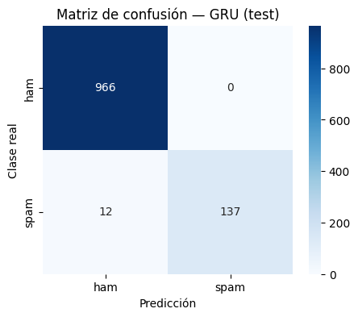

# SMS Spam Detection with Recurrent Neural Networks

Comparison of **SimpleRNN, LSTM and GRU** (Keras Functional API) for classifying SMS messages as spam or ham on the UCI *SMS Spam Collection* (5,574 messages, ≈ 13 % spam), with class weighting, Keras Tuner and a validation-only model selection.

> 🇪🇸 *Clasificación de SMS (spam/ham) con SimpleRNN, LSTM y GRU, pesos de clase, Keras Tuner y selección del modelo solo con validación. El notebook está en español.*



## Results

**Validation (model selection)**

| Model | Accuracy | Precision | Recall | F1 | Parameters |
|---|---:|---:|---:|---:|---:|
| **GRU** | **0.984** | 0.973 | **0.908** | **0.940** | 345,025 |
| LSTM | 0.980 | 1.000 | 0.850 | 0.919 | 353,089 |
| SimpleRNN | 0.976 | 0.990 | 0.833 | 0.905 | 328,321 |

**Test (single evaluation of the selected GRU):** accuracy 0.989 · precision 1.000 · recall 0.920 · F1 0.958.

- **Zero false positives.** No legitimate message was blocked. All 12 errors are spam that got through.
- The **missed spam is "subtle"**: short messages without the usual urgency markers (£, FREE, WIN) or written like personal texts.
- **More parameters did not mean better.** The GRU beat the larger LSTM on accuracy, recall and F1, and SimpleRNN showed the most overfitting.

## Design decisions

| Decision | Choice and reason |
|---|---|
| Sequence length | `MAXLEN` = 95th percentile of training lengths, post-padding and post-truncation |
| Imbalance | `class_weight` computed on the training set only (spam 3.73, ham 0.58) |
| Main metric | F1, since accuracy rewards always predicting "ham" (≈ 87 %) |
| Tuning | Keras Tuner Hyperband on `units` [32–128] and `dropout_rate` [0.1–0.5]; best: units = 96, dropout = 0.2 (val_loss 0.0617, 28 trials) |
| Training | EarlyStopping (patience 3, restore best weights), ReduceLROnPlateau (factor 0.5), ModelCheckpoint on `val_loss` |
| Leakage control | Tokenizer and class weights fit on training data; test set used once, after selection |

## Next steps

Apply the tuned hyperparameters to the final GRU and tune the GRU directly. Try pre-trained embeddings (GloVe or fastText) and text augmentation to recover the subtle spam.

## How to run

```bash
pip install -r requirements.txt
jupyter notebook sms_spam_rnn.ipynb
```

The dataset is downloaded from the UCI repository at run time.

## Stack

Python · TensorFlow / Keras · Keras Tuner · scikit-learn · pandas · seaborn · matplotlib

**Author:** Mateo Aranguren
